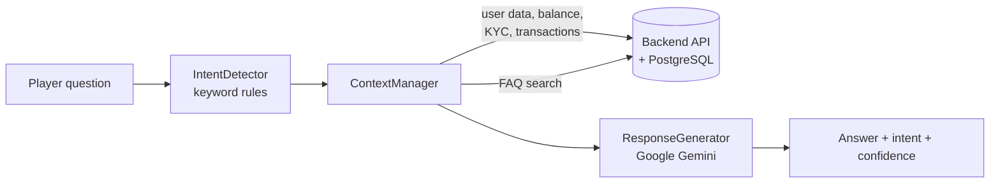

# Gaming Platform API with an AI Support Agent

[](https://github.com/shorif-mahmud-abdullah/ai-agent-demo/actions/workflows/ci.yml)


A FastAPI backend for a gaming platform (accounts, balances, transactions, KYC status, FAQs, support tickets) with an AI customer-support agent on top. The agent detects what the player is asking, pulls the player's real data and matching FAQs from the API, and asks Google Gemini to write a grounded answer.

This is a personal prototype built to practise a layered backend design and LLM-with-context patterns. It uses seeded dummy data, not real users.

## How the AI agent works



1. **IntentDetector** maps the question to an intent such as `balance_check`, `withdrawal`, `kyc_status` or `human_request`.
2. **ContextManager** fetches only the data that intent needs (for example the balance for `balance_check`) plus matching FAQs.
3. **ResponseGenerator** sends the question and that context to Gemini, so answers are based on the player's actual account data.
4. **GamingAIAgent** orchestrates the three steps and keeps per-conversation history.

## Project structure

```
src/
├── main.py            # FastAPI app, routers, startup seeding
├── config/            # settings (env-driven)
├── database/          # SQLAlchemy engine, session, models
├── schemas/           # Pydantic request/response models
├── services/          # business logic (auth, users, support)
├── ai/                # intent detection, context, Gemini response, orchestrator
├── api/routes/        # auth, users, support, ai_agent endpoints
├── auth/              # JWT dependencies
└── utils/             # dummy-data seeder
tests/                 # pytest suite (no database needed)
```

## Quick start

You need Python 3.12+, a PostgreSQL database and a Gemini API key.

```bash
# 1. PostgreSQL (one-liner with Docker)
docker run -d --name gaming-db -p 5432:5432 \
  -e POSTGRES_PASSWORD=postgres -e POSTGRES_DB=gaming_prototype postgres:16

# 2. Install
python -m venv .venv && source .venv/bin/activate
pip install -r requirements.txt

# 3. Configure
cp .env.example .env        # then add your GEMINI_API_KEY and a random SECRET_KEY

# 4. Run
uvicorn src.main:app --reload
```

Open http://localhost:8000/docs for the interactive API docs. On first start the app creates the tables and seeds dummy users, transactions and FAQs.

## Main endpoints

| Area | Endpoints |
|---|---|
| Auth | `POST /api/auth/register`, `POST /api/auth/login`, `GET /api/auth/me` (JWT bearer tokens) |
| Users | `GET /api/users/{id}`, `/api/users/{id}/balance`, `/api/users/{id}/transactions`, `/api/users/{id}/kyc-status`, plus `/api/users/me/...` variants for the logged-in user |
| Support | `GET /api/faqs`, `GET /api/faqs/search`, `POST /api/support-tickets`, `GET /api/support-tickets/{id}` |
| AI agent | `POST /api/chat` (authenticated), `POST /api/chat/public` |
| Ops | `GET /health` |

## Tests

```bash
pip install -r requirements-dev.txt
python -m pytest -q
```

The suite covers intent detection, password hashing and JWT creation, and the root and health endpoints. It runs without PostgreSQL or a Gemini key, and GitHub Actions runs it on every push.

## Known limitations

- Intent detection is keyword-based and the first matching intent wins, so an ambiguous question such as "add money" is read as a balance check. An LLM or embedding classifier would be the next step.
- Conversation history is kept in memory, not in the database.
- Dummy data only; there are no real payments.

## Tech

FastAPI · SQLAlchemy · PostgreSQL · Pydantic · JWT (python-jose) · passlib/bcrypt · Google Gemini · pytest · GitHub Actions
